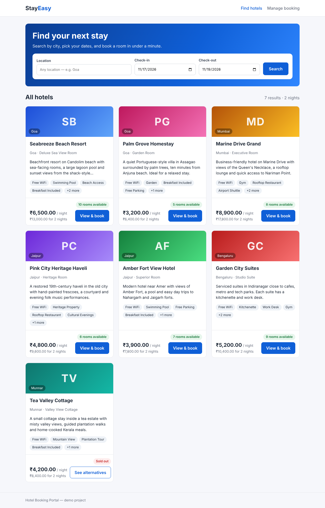
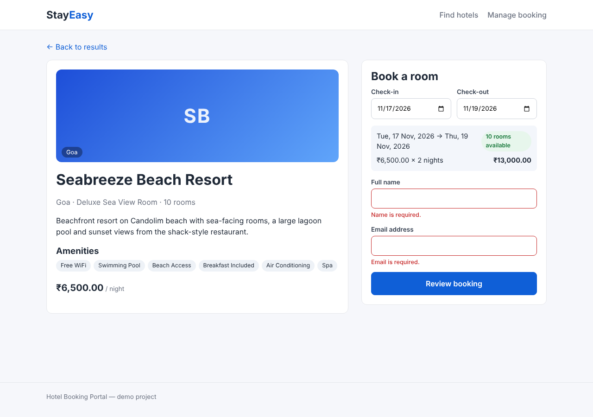
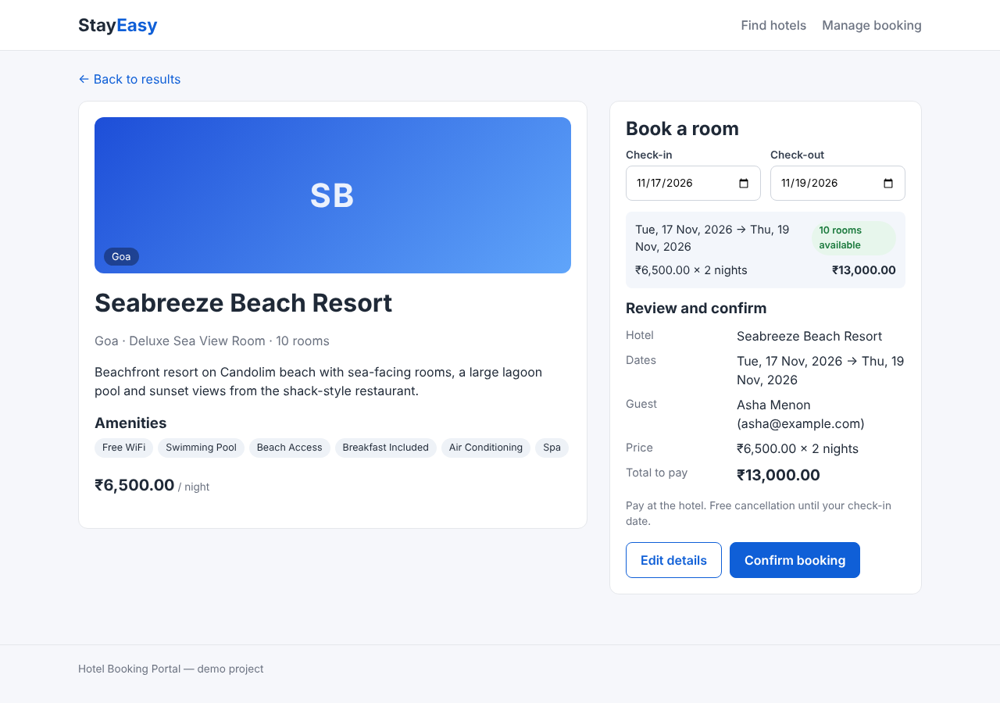
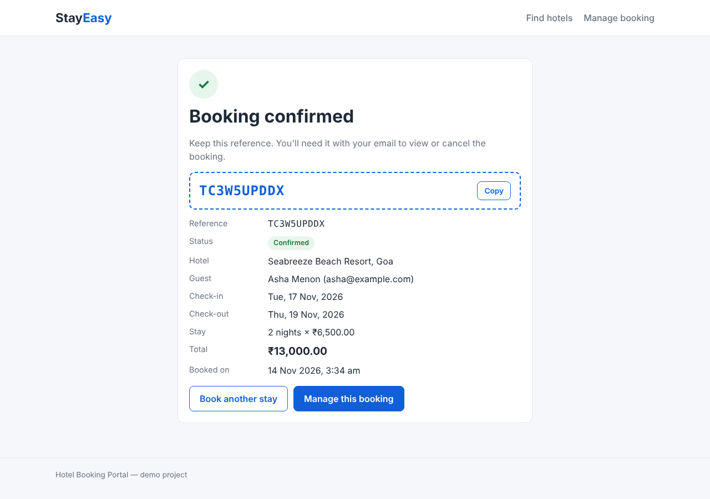
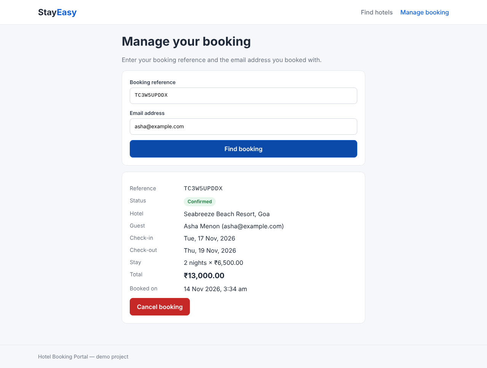
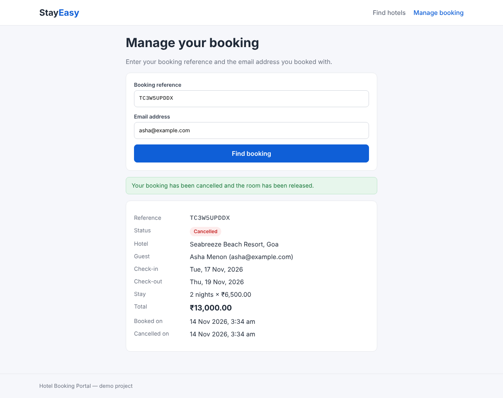
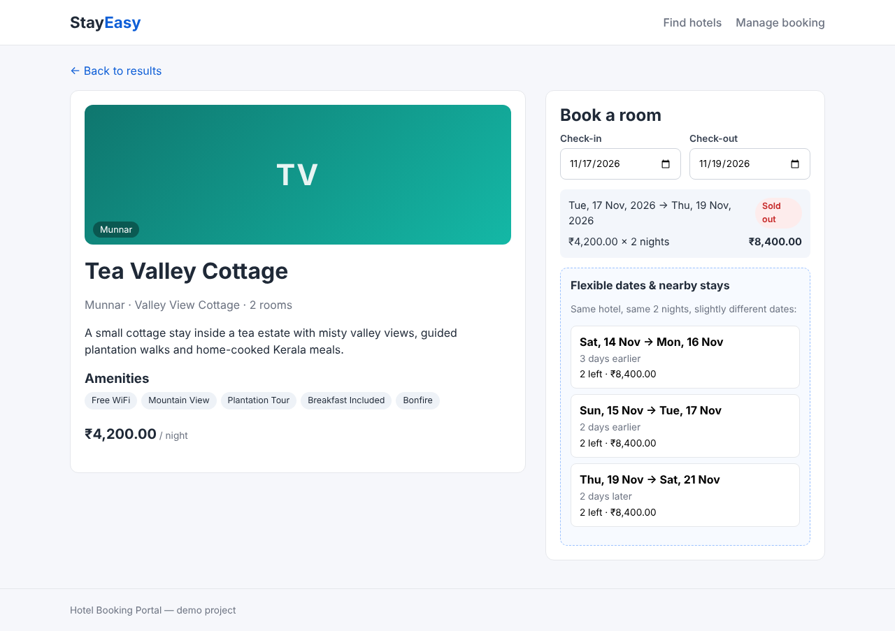

# Hotel Booking Portal

A small full-stack hotel booking portal. You can browse and search hotels, check availability for your dates, see the total price before you confirm, book a room, and look up or cancel a booking using its reference and your email.

**Surprise feature: "Flexible dates & nearby stays".** When a hotel is sold out for your dates, the page doesn't stop there. It suggests the closest free dates at the same hotel (same number of nights, up to ±7 days) and other hotels in the same city that still have rooms. You can book either with one click. See [DESIGN.md](DESIGN.md#7-surprise-feature).

| Layer | Tech |
|---|---|
| Backend | Java 17, Spring Boot 3.3 (Web, Data JPA, Validation), Flyway |
| Frontend | React 18, React Router, Vite |
| Database | MySQL 8 (tests use in-memory H2) |

```
hotel-booking-portal/
├── backend/            Spring Boot REST API
│   ├── src/main/java/com/hotelportal/
│   │   ├── web/         controllers (HTTP only)
│   │   ├── service/     booking rules, pricing, availability, alternatives
│   │   ├── repository/  Spring Data JPA repositories
│   │   ├── domain/      JPA entities
│   │   ├── dto/         request/response records
│   │   ├── exception/   ApiException + global error handler
│   │   └── config/      CORS, Clock
│   ├── src/main/resources/db/migration/   Flyway: V1 schema, V2 sample data
│   └── src/test/        unit + integration tests
├── frontend/           React app
├── database/setup.sql  creates the MySQL database and user
├── docs/screenshots/   screenshots of the main flow
└── DESIGN.md           design write-up
```

## Prerequisites

- **Java 17+** (`java -version`)
- **Maven 3.9+** (`mvn -v`)
- **Node.js 18+** and npm (`node -v`)
- **MySQL 8.0.16+** running on `localhost:3306`. CHECK constraints are only enforced from 8.0.16.

## Run it locally

### 1. Create the database

Open `database/setup.sql` and change the `change_me` password. Then run:

```bash
mysql -u root -p < database/setup.sql
```

This creates the `hotel_booking` database and a `hotel_app` user. You don't create any tables yourself: Flyway creates them, along with 7 sample hotels, the first time the backend starts.

### 2. Configure credentials (kept out of git)

```bash
cd backend
cp .env.example .env        # Windows: copy .env.example .env
```

Edit `backend/.env` and set `DB_PASSWORD` to the password you chose. `.env` is git-ignored. You can also set `DB_URL`, `DB_USERNAME` and `DB_PASSWORD` as normal environment variables instead.

### 3. Start the backend (port 8080)

```bash
cd backend
mvn spring-boot:run
```

Check it works: open http://localhost:8080/api/hotels. You should see 7 hotels as JSON.

### 4. Start the frontend (port 5173)

```bash
cd frontend
npm install
npm run dev
```

Open **http://localhost:5173**. Vite forwards `/api` calls to the backend.

### 5. Run the tests

```bash
cd backend
mvn test
```

The tests use an in-memory H2 database, so MySQL doesn't need to be running. They cover:

- **Pricing and dates:** total = price × nights, check-out after check-in, no past check-in, maximum stay length.
- **Availability:** capacity is enforced, a partly overlapping stay counts against capacity, back-to-back stays are allowed, and a failed booking reserves nothing.
- **Cancellation:** cancelling releases the room; you can't cancel twice.
- **Lookup:** both the reference and the email must match.
- **Two people booking the last room at once:** exactly one booking succeeds.
- **Alternatives:** suggested dates really are available.
- **API errors:** the error format is the same everywhere (field errors, past dates, bad date format, 404s).

## Try the main flow

1. Search for **Goa** with dates a few days from now, then click **View & book**.
2. Enter your name and email, click **Review booking** to see the total calculated on the backend, then click **Confirm booking**.
3. Copy the booking reference, go to **Manage booking**, enter the reference and your email, and cancel.
4. To see the surprise feature, book **Tea Valley Cottage** (Munnar). It has only 2 rooms, so book the same dates twice. On the third try it shows as sold out with alternative dates and nearby stays.

## Screenshots

| | |
|---|---|
| Search results with availability and total |  |
| Validation messages |  |
| Review step: backend-calculated total before confirming |  |
| Confirmation with unique reference |  |
| Retrieve booking by reference and email |  |
| Cancelled booking |  |
| Surprise feature: sold out → flexible dates and nearby stays |  |

## API summary

| Method | Path | Purpose |
|---|---|---|
| GET | `/api/hotels?location=&checkIn=&checkOut=` | Browse or search; with dates, includes rooms left and total |
| GET | `/api/hotels/locations` | Distinct locations for the search box |
| GET | `/api/hotels/{id}?checkIn=&checkOut=` | Hotel details |
| GET | `/api/hotels/{id}/availability?checkIn=&checkOut=` | Rooms left plus the backend price quote |
| GET | `/api/hotels/{id}/alternatives?checkIn=&checkOut=` | Surprise feature: nearby dates and similar hotels |
| POST | `/api/bookings` | Book one room → `201` with reference |
| POST | `/api/bookings/lookup` | Get a booking by `{reference, email}` |
| POST | `/api/bookings/{reference}/cancel` | Cancel (body `{email}`) |

Dates use `YYYY-MM-DD`. Every error returns `{timestamp, status, error, code, message, path, fieldErrors[]}`.

## Time spent, unfinished items and AI use

- **Approximate time spent:** _<fill in>_ hours.
- **Not done (out of scope per the brief):** authentication, payments, admin panel, cloud deployment.
- **Not done (would add with more time):** email confirmations, multiple room types per hotel, automated frontend tests, Docker Compose setup. See [DESIGN.md §8](DESIGN.md#8-limitations-and-improvements).
- **AI assistance:** I used an AI assistant (Claude) heavily to write the code, tests and documentation. I reviewed the code and design and can explain the decisions. Because of time constraints I have not yet run the backend locally, so the screenshots show the frontend running against a temporary stand-in for the API.
